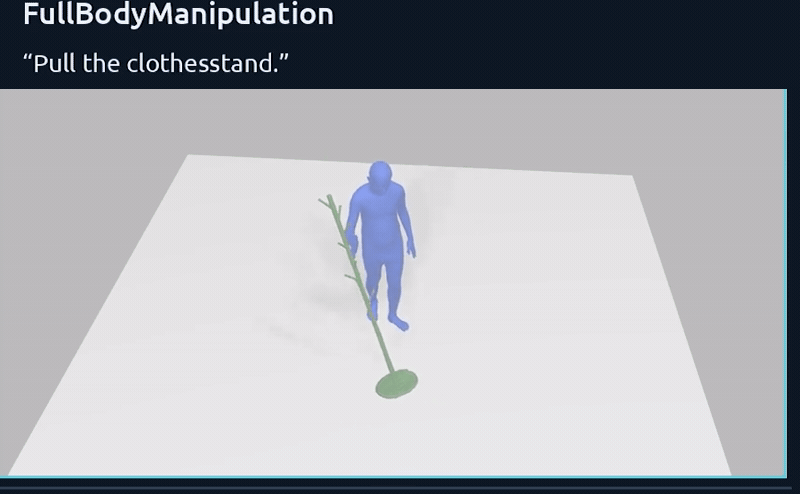

# TriFactorHOI：基于结构化扩散的可控人-物交互生成

> 一个条件扩散生成器打底，外加两个接触修正模块：手部穿透降 8.4%，脚滑降 21.1%。

**类型** 论文 · **角色** 第一作者 · **状态** ICLR 2027 在投 · **时间** 2026

[← 返回首页](../../README.md)

## 一、任务定义

- **输入**：一句自然语言指令，加上物体的 3D 几何（点云）、初始的人-物状态，以及几个稀疏路点（waypoints）。
- **输出**：一段 T 帧的动画——人体全身动作与刚体物体位姿同步演化，沿着用户指定的路线完成交互。
- 比如「Pull the clothesstand.」：给一个衣架的 3D 模型和这句话，模型要生成一个人走过去、抓住衣架、把它拉到目标位置的一整段动作。

## 二、基座（一笔带过）

- 论文本体是一个条件扩散模型：文本 + 物体点云 + 初始状态 + 稀疏路点作条件，输出 T 帧的人-物同步动作。
- 三个因子各管一段：**Path** 把路点插值成参考路径、网络只学平面位移的残差；**Part** 把人和物拆成 7 个语义部件，用「时间 × 部件」两个轴做注意力；**Contact** 在去噪后期施加接触引导。
- 这部分是论文主线。我主要的工作量在下面两块接触修正上——它们都不重训生成器，直接接在采样结果后面。

## 三、手部修正器：VLM 打分 → critic → RL 残差策略

- **要解决什么**：生成出来的手经常贴不住物体、朝向不对，甚至直接穿进去。
- **为什么不做端到端**：手部错误是局部的，为了它重训整个生成器不划算；做成后处理，既能即插即用，也不破坏已经对齐的路点和脚部。
**第一步：用 VLM 给手部打分，造训练标签**

- 对单帧手部按「方位 / 放置 / 穿透」三个维度各打 0–3 分，攒出 92,616 条标签；
- 标签来源混了五路：GT 20,000、MaMi-HOI 15,643、TriFactorHOI 16,873、3D-FUTURE 10,000、InterAct 30,100；
- 按原始序列分组做隔离，避免同源序列跨训练/验证泄漏。

**第二步：训练 ContactNet 接触质量判别器**

- **网络**：共享的逐点 MLP（6 → 64 → 128 → 192）→ max + mean 池化 → 融合层 768 → 192 → 96，约 20 万参数；
- **输入**：完整手部 256 个点；物体只取掌心 25 cm 范围内的点（点池 3072 里取 1536 个）；每个点带 XYZ（米）和法向；手部统一到掌心坐标系，左右手都转成右手系；
- **输出**：方位 / 放置 / 穿透三个 0–3 的期望分数，外加一个独立的好坏分数；
- **训练**：3 个种子 × 5 折，按验证集三项平均 MAE 选 checkpoint；
- **效果**：OOF AUROC 0.907，三项 MAE 0.38 / 0.23 / 0.38，约合满量程（0–3）的 12.5% / 7.6% / 12.8%。

**第三步、第四步**：待补。

- **结果**（482 条 FullBody 序列、67,034 个 hand-contact 状态）：
  - 手部穿透 0.5313 → 0.4868，**降 8.4%**；
  - 接触精度 0.8081 → 0.8147（+0.8%），R-Prec 0.7354 → 0.7438（+1.1%）；
  - 代价：FID 0.3767 → 0.3844（+2.0%），MPJPE +0.2%；
  - 438 / 482 条序列被修正，平均手部关节位移 1.25 cm，物体尺寸、root、脚部指标完全不变。

## 四、脚部修正网络：低噪声成对数据 + 相位感知 + 锚点 IK

- **要解决什么**：脚滑——支撑脚在世界坐标里挪动，看起来「飘」。
- **关键在数据**：以同一段干净动作为目标，只对脚部的世界坐标施加低幅、可控的扰动来生成「退化」样本，接触相位、落脚时刻和步频严格保持不变。这样「退化–干净」对步调一致，监督信号只反映脚放得准不准，不会逼网络去改动作语义。
- **模型**：47 维逐帧特征 → 6 层 8 头 Transformer（D256、ff 1024）→ 每帧预测接触相位（无接触 / 脚跟 / 脚尖）、接触事件、支撑置信度，以及左右脚 XY 锚点偏移（±4 cm）。
- **后处理**：网络给出的相位与锚点交给世界坐标锚定，再用时序 IK 解出脚部姿态，最后做地面校正（2 mm margin、5 帧平滑）。IK 只是求解器，决定「改哪里、改多少」的是网络。
- **结果**：
  - 脚滑 0.2972 → 0.2344，**降 21.1%**；脚高 −0.2%；
  - 代价：FID 0.3569 → 0.3767（+5.5%），MPJPE +0.4%。

## 五、其余（一笔带过）

- **路径因子**：同输入下换成「参考路径 + 残差」表示，路点误差 1.01 → 0.13 cm，FID 0.37 → 0.34。
- **部件 tokenization**：7 个语义部件比 8 帧一码（FID 8.38）和全局 210 帧注意力（5.67）都好，本方法 FID 0.3767。
- **泛化**：未见过的 3D-FUTURE 物体不重训，9 项指标全部领先或持平；路点加 15 cm 噪声（平均偏移 18.87 cm）后仍跟着扰动路线走。
- **效率**：每序列采样约 5.53 s，峰值显存 16.46 GB。
