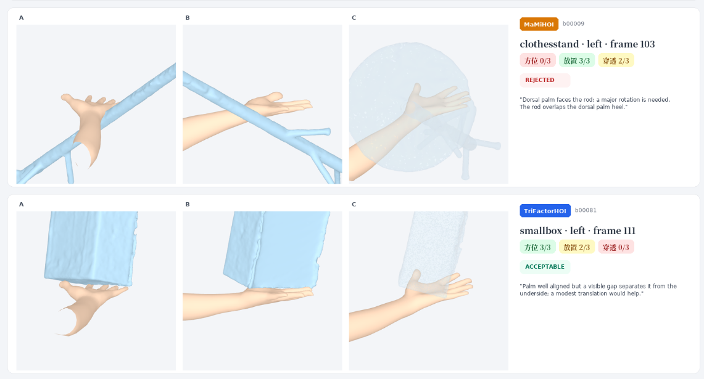
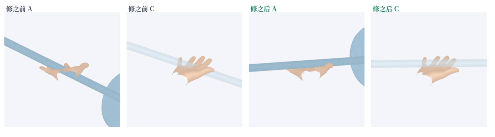

# TriFactorHOI：基于结构化扩散的可控人-物交互生成

> 一个条件扩散生成器打底，外加两个接触修正模块：手部穿透降 8.4%，脚滑降 21.1%。

**类型** 论文 · **角色** 第一作者 · **状态** ICLR 2027 在投 · **时间** 2026

[← 返回首页](../../README.md)

## 一、任务定义

- **输入**：一句自然语言指令，加上物体的 3D 几何（点云）、初始的人-物状态，以及几个稀疏路点（waypoints）。
- **输出**：一段 T 帧的动画——人体全身动作与刚体物体位姿同步演化，沿着用户指定的路线完成交互。
- 比如「Pull the clothesstand.」：给一个衣架的 3D 模型和这句话，模型要生成一个人走过去、抓住衣架、把它拉到目标位置的一整段动作。

## 二、基座（一笔带过）

- 论文本体是一个条件扩散模型：文本 + 物体点云 + 初始状态 + 稀疏路点作条件，输出 T 帧的人-物同步动作。
- 三个因子各管一段：**Path** 把路点插值成参考路径、网络只学平面位移的残差；**Part** 把人和物拆成 7 个语义部件，用「时间 × 部件」两个轴做注意力；**Contact** 在去噪后期施加接触引导。
- 这部分是论文主线。我主要的工作量在下面两块接触修正上——它们都不重训生成器，直接接在采样结果后面。

## 三、手部修正器：VLM 打分 → critic → RL 残差策略

- **要解决什么**：生成出来的手经常贴不住物体、朝向不对，甚至直接穿进去。
- **为什么不做端到端**：手部错误是局部的，为了它重训整个生成器不划算；做成后处理，既能即插即用，也不破坏已经对齐的路点和脚部。
**第一步：用 VLM 给手部打分，造训练标签**

- 对单帧手部按「方位 / 放置 / 穿透」三个维度各打 0–3 分，攒出 92,616 条标签；
- 标签来源混了五路：GT 20,000、MaMi-HOI 15,643、TriFactorHOI 16,873、3D-FUTURE 10,000、InterAct 30,100；
- 按原始序列分组做隔离，避免同源序列跨训练/验证泄漏。

**第二步：训练 ContactNet 接触质量判别器**

- **网络**：共享的逐点 MLP（6 → 64 → 128 → 192）→ max + mean 池化 → 融合层 768 → 192 → 96，约 20 万参数；
- **输入**：完整手部 256 个点；物体只取掌心 25 cm 范围内的点（点池 3072 里取 1536 个）；每个点带 XYZ（米）和法向；手部统一到掌心坐标系，左右手都转成右手系；
- **输出**：方位 / 放置 / 穿透三个 0–3 的期望分数，外加一个独立的好坏分数；
- **训练**：3 个种子 × 5 折，按验证集三项平均 MAE 选 checkpoint；
- **效果**：OOF AUROC 0.907；相对 0–3 满量程，方位 / 放置 / 穿透三项的误差分别是 **12.5% / 7.6% / 12.8%**。

**第三步：监督预训练**

- 从 92,616 条真实标签里筛「精英教师」——三个维度都拿满（方位 3、放置 3、穿透 0）的手，共 3,230 个，分布在 1,176 段动作里；
- 每个教师造 32 个扰动样本，凑出 103,360 对「坏手 → 好手」，监督网络学会把扰动过的手拉回教师手；
- 验证集 MAE 0.4060 → 0.1951，留出测试 MAE 0.1973。

**第四步：以 C 为奖励做强化微调**

- **奖励**：把 C 的三个维度按验收线取概率再加权——
  `reward = 0.3 · P(方位 ≥ 2) + 0.2 · P(放置 ≥ 2) + 0.5 · (1 − P(穿透 ≥ 2))`，
  即「朝向对、位置对」加分，「有穿透」扣分，其中穿透权重最高；
- 冻结 C，用 PPO 在 92,616 条真实状态上继续微调 9 维手链残差策略（3 维平移 + 6 维旋转）；
- 训练中累计约 1,239 万次 action–reward 评估；
- 最终部署的是 `flat_g03_w20_s2026102308` 这个 checkpoint。

- **结果**（482 条 FullBody 序列、67,034 个 hand-contact 状态）：
  - VLM 盲测 212 条里，**117 条判为可接受（55.2%）**；
  - 手部穿透 0.5313 → 0.4868，**降 8.4%**；
  - 接触精度 0.8081 → 0.8147（+0.8%），R-Prec 0.7354 → 0.7438（+1.1%）；
  - 代价：FID 0.3767 → 0.3844（+2.0%），MPJPE +0.2%；
  - 438 / 482 条序列被修正，平均手部关节位移 1.25 cm，物体尺寸、root、脚部指标完全不变。

## 四、脚部修正网络：关键是合成数据对

- **要解决什么**：脚滑——支撑脚在世界坐标里挪动，看起来「飘」。
- **为什么得造数据**：真实生成结果里，脚滑和各种动作误差混在一起，手上没有「同一段动作、只差脚」的成对样本；如果直接拿 GT 当目标，网络会顺手把动作、步态一起改掉，那就不是「修脚」了。

### 第一步：合成「坏–好」数据对

- **先训一个只处理人体的辅助去噪器**：HumanML3D，69,616 段训练 / 8,314 段验证，每段 120 帧；沿用 part-based 时空结构，但去掉文本、物体、路点条件。损失除关节位置和旋转，还额外加了脚踝 / 脚尖位置、接触帧速度、脚尖高度的约束。训完冻结，只用来造数据，不进 HOI 推理。
- **加低噪声、一次前向重建**：对每段干净动作加一个很低噪声，让冻结网络一次前向预测，再把 root 的平移和旋转还原回去——全局位移不变，局部重建误差主要留在脚上。
- **成对**：重建出来的 J⁻ 和原始 J⁺ 就是一对；因为扰动很轻，步频、落脚时刻、接触相位都跟原动作对齐。
- **这样监督信号只回答一件事**：这只脚「放得准不准」，而不是「动作该怎么改」。

### 第二步：支撑相位与置信度

- **输入**：47 维逐帧特征——root 位移、root 相对的下肢位置、脚踝 / 脚尖的帧间差、脚高、归一化时间。
- **网络**：6 层 8 头 Transformer（D256、ff 1024），一整段 120 帧一起看，逐帧输出左右脚的三态概率（swing / toe-support / flat-support）与修正置信度。
- **标签从干净动作反推**：脚尖高度 + 水平位移判定支撑；置信度目标是支撑期扰动脚位与干净脚位的水平差——它衡量「需要修多少」，而不只是「接没接触」。

### 第三步：从预测到修正

- 支撑概率用 0.60 / 0.35 的迟滞转成连续区间，避免在不确定处反复切换；
- 支撑开始时用生成动作的脚位建世界坐标锚点（脚尖；平踩时再加脚踝），把脚往锚点方向带；
- 时序 DLS-IK 调髋 / 膝 / 踝，并对相邻支撑帧的水平位移加惩罚压脚滑，最后地面校正（2 mm margin、5 帧平滑）。

### 结果

- 脚滑 0.2972 → 0.2344，**降 21.1%**；脚高 −0.2%；
- 代价：FID 0.3569 → 0.3767（+5.5%），MPJPE +0.4%。

## 五、其余（一笔带过）

- **路径因子**：同输入下换成「参考路径 + 残差」表示，路点误差 1.01 → 0.13 cm，FID 0.37 → 0.34。
- **部件 tokenization**：7 个语义部件比 8 帧一码（FID 8.38）和全局 210 帧注意力（5.67）都好，本方法 FID 0.3767。
- **泛化**：未见过的 3D-FUTURE 物体不重训，9 项指标全部领先或持平；路点加 15 cm 噪声（平均偏移 18.87 cm）后仍跟着扰动路线走。
- **效率**：每序列采样约 5.53 s，峰值显存 16.46 GB。
