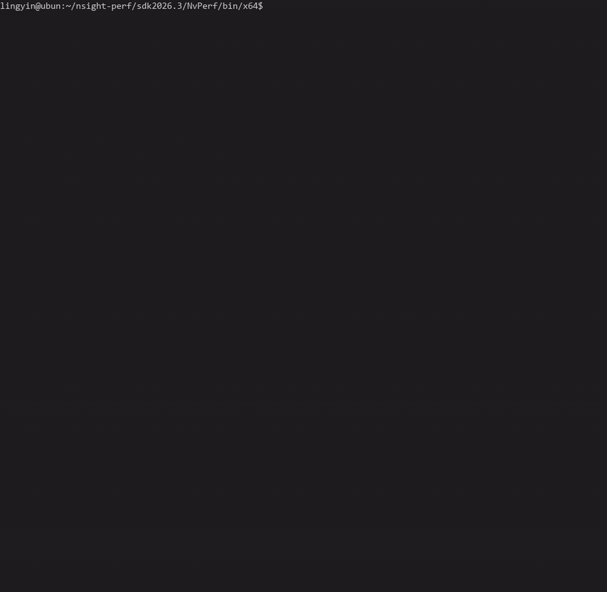

# 英伟达半导体科技（上海）｜ PerfWorks / PerfSDK 性能监测团队

> 驱动 GPU 硬件计数器采样、并将原始 counter 解码为指标，为 Nsight System 提供底层支持。

**时间** 2026.03 – 2026.11 · **角色** Software Engineer Intern

[← 返回首页](../../README.md)

## 轻量级 GPU 性能监测（Monitoring）

- 实现跨平台命令行、可配置指标采集与 UI 展示的 GPU 指标监测工具，100 fps 采样下 CPU 占用通常低于 2%，随 [Nsight Perf SDK 2026.3](https://developer.nvidia.com/nsight-perfsdk/getting-started/release-note-v2026.3) 发布。

### 技术实现

- **采样**：基于 Nsight Perf SDK 的 periodic sampler，按固定周期向 GPU 取硬件计数器（约 10 ms 一次，对应 100 fps 的刷新粒度）；一次请求批量读取一组 metric，避免逐 counter 触发查询。
- **线程模型**：采样与渲染分线程，中间用预分配的环形缓冲传递快照；渲染端只读最新一帧，终端刷新慢不会反向拖慢采样。
- **终端 UI**：跨平台终端抽象，用 ANSI 转义序列做整屏重绘与差异刷新，只重画数值变化的行，避免全屏刷新的终端开销。
- **可配置指标**：启动时读取配置/参数里的 metric 列表，先用 CounterAvailability 过滤当前 GPU 不支持的指标，再组装采样请求，指标名与显示格式分开配置。
- **低开销**：热路径零分配、缓冲区复用，采样不被渲染阻塞；CPU 侧只做增量更新与阈值判断，因此 100 fps 下占用通常低于 2%。
- **跨平台**：命令行解析、计时器、终端尺寸与按键处理各抽一层，Windows 与 Linux 共用同一套采样和渲染逻辑。

### 难点

- 有性能要求，所以需要无锁编程，以及一些常见的代码优化。
- 如果 CPU 卡住，GPU 端的 PMA buffer 会溢出并停止采样，需要自动重启采样。
- Monitoring 是“低频”采样工具，很多 counter 不能用，需要过滤（如 `graphics-low-speed-1.yaml`）。

## Profiler 离线解码（Offline Decode, CUDA 13.5-nsight-perf-sdk-for-ai 的核心之一）

- **是什么**：把 GPU 采集下来的原始数据解码成人类可读的指标。
- **输入**：一堆人类不可读的二进制数据——GPU counter 原始数据、trace buffer、counter 的启用情况等。
- **输出**：人类可读的 metric 数据（double）。
- **怎么做**：按采样上下文组合各种 counter，结合硬件情况做数据转换与处理。

### 一、用于 decoder 的调试

- 在 PerfSDK / PerfWorks 开发中发现问题时，用离线解码把「采样」和「解码」拆开：先确认采集侧的数据对不对，再看解码侧算得对不对，问题出在哪一段一目了然。
- 采样本身很贵，解码才是耗时大头；把解码移出采集路径后，采集侧只把 counter 落成 Snapshot，事后重建 Decoder 离线解码，采样不再被解码拖累，可以全速跑满全部 counter。
- 复现：理论上采样拿不到两份完全相同的数据，问题难以稳定重现；而 Snapshot 可以反复解码、反复使用，排查始终回到同一份原始数据上。

### 二、nsight-perf-sdk-for-ai

- CUDA 13.5 首次提出 nsight-perf-sdk-for-ai 的概念。
- Perfetto Trace Exporter 与 Continuous Export 都用了离线解码：采集侧只落盘，解码放到之后做。
- 为 AI 场景把监测对系统的干扰压到最低，[综合性能开销低于 1%](https://github.com/NVIDIA/nsight-perf-sdk-for-ai#continuous-low-overhead-profiling)。

## 存量代码的 AI 审查（AI Code Review）

- 存量千万行 C/C++ 的全量 AI 审查不可行——可疑点远超人工确认能力；提出只筛高置信、与业务无关的局部缺陷，经 10 万行抽样验证，检出 6 个高置信 bug、成本不到 1 美元，外推全仓不到 500 美元，极大减轻人工排查压力。
