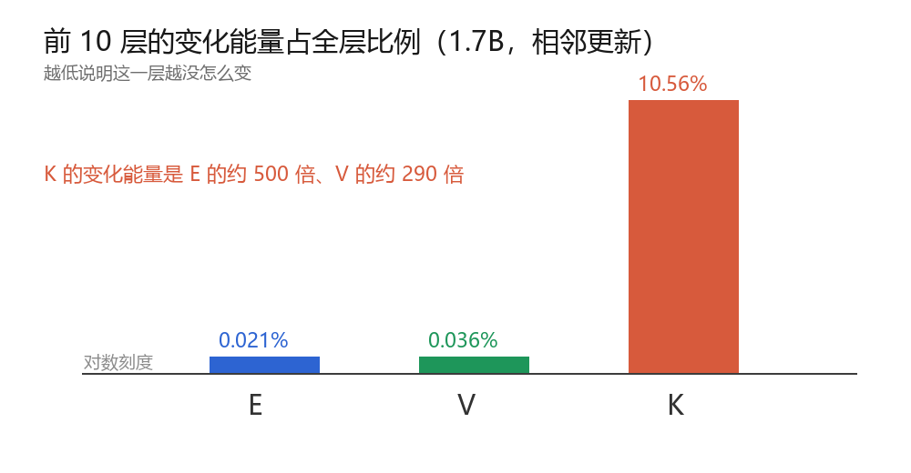
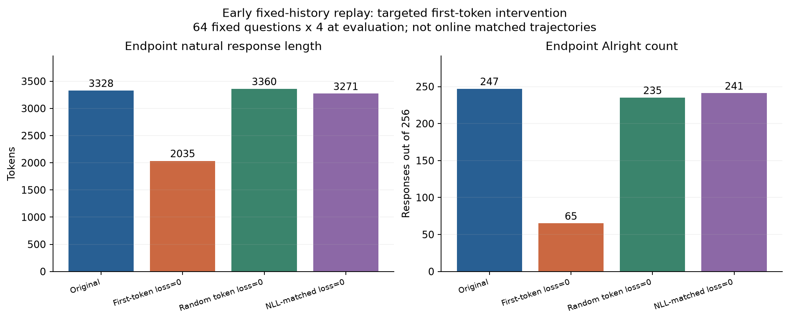

# RL 训练效率与稳定性：采样策略与异常梯度

> Qwen3-8B 数学 RL 上的两条研究线：长尾调度到底省不省时间，以及长度跃升 / 梯度异常 / 循环输出由什么驱动。45 个实验单元、52 条 claim，一半结论是被推翻的假设。

**类型** 项目 · **角色** 研究 + 工程 · **时间** 2026 · **状态** 已完成（八组对照只跑完 5/8）

[← 返回首页](../../README.md)

## 一、早期 1.7B 调度对照：常见的异步 rollout 方法

在 8B 之前，先用 Qwen3-1.7B-Base、DeepMath 20,000 题、4,096 token 上限跑了约 24 小时的长跑，横向看几类常见方案各自怎么处理「没完成的回答」：

| 方案 | 如何处理未完成的工作 | 24h 轮次 | 平均耗时 | DeepMath mean@4 | MATH transfer |
| :-- | :-- | --: | --: | --: | --: |
| 同步 DAPO | 等整组完成再更新 | 2,340 | 48.00 s | 51.90% | 63.28% |
| APRIL | 保留已生成的 token 前缀，跨权重更新续写 | **2,782（+18.9%）** | **30.45 s** | 53.59% | 65.04% |
| RollPacker（固定窗口 70） | 跨更新只保留题目、重新生成；短轮 + FIFO 长池 | 2,369 | 43.06 s | **55.15%** | **66.16%** |
| TailSieve | 长池与普通池并行，优先纳入长池有效组，再补足 56 组 | 2,465 | 35.63 s | 54.61% | **66.16%** |
| RollVerify | 按生成段和 token 两级校验旧前缀 | 1,806 | 54.62 s | 49.49% | — |

> RollPacker 另有一条「适配版」run（第 76 轮把窗口 112 改成 70），中途改配置，只能当过程记录；上表用的是固定窗口 70 的重跑。

### 1.1 我们怎么改这些机制

- **APRIL**：论文是一次性发起约 2 倍的组、每轮训练完再补题；我们改成**任意题目被消耗就补题**，让 GPU 上始终有 `112 × 8` 条 prompt 在跑，尽量不出现「一轮末尾没活干」的空档。
- **RollPacker**：论文一次性起 1.2 倍 prompt、G=10，每题只取最早的 8 条；我们保留动态补题，但**去掉了「10 拿 8」**，直接按 G=8 采——组的构成更简单，也少了一层按完成时间挑样本的偏差。
- **TailSieve**：长池和普通池并行，等长池判分完优先取它的有效组，再从普通池按完成顺序补足 56 组。
- **RollVerify**：基本是复现——按生成段和 token 两级校验可复用的旧前缀；但第 8 步窗口平均接受率只有 0.4113，太低，直接切回了同步生成。

四组共用同一套 1.7B / 4k / 56 个有效组的设置，所以横向看的是**机制差异**，不是论文原配置的复现。

## 二、跨权重 KV 复用：我们发现了什么

这是另一条独立线：权重更新之后，能不能拿旧缓存 + 已知的参数增量，低成本算出新缓存，从而省掉一部分 prefill？

诊断都是在 **Qwen3-1.7B** 上做的：全参数 AdamW、lr 1e-6、每轮 32 题 × 8 回答、一次更新，保存 000–003 四个 checkpoint；输入上限 2048、回答上限 8192，FP32、禁 TF32。比较的是「同一串 token 在相邻权重下」的缓存，用 teacher forcing 看后续分布，不是自由生成。

### 2.1 发现一：浅层的 E/V 几乎没变，K 变了很多

- 逐层统计变化能量（占 28 层总变化的中位数）：前十层 **E 0.0209% / V 0.0361%，而 K 是 10.56%**。
- 这直接指向一个分层方案：**浅层旧 E、旧 V 复用，K 用新 Wk 重算，中高层整段重算**。浅层 K 的投影还能层间并行。

### 2.2 发现二：增量「看起来有规律」，但压不缩

- 未参与训练的探针上，E / K-cache / V-cache 的相邻相对变化中位数只有 **0.296% / 0.214% / 0.406%**；
- 但 rank-64 最优拟合仍留下 **34.4% / 28.7% / 32.2%** 的增量误差；权重增量本身更难低秩拟合（Wk/Wv 的 rank-64 残差约 **70.1% / 68.6%**）；
- 换二维 Fourier 拟合带符号增量，留出 token 上误差仍约 **99.85% / 99.65% / 100.14%**——灰度图上的条纹没有变成可泛化的坐标函数。

### 2.3 发现三：知道 ΔW，不等于知道新的激活

线性投影满足 `(E+e)(W+w) = EW + eW + Ew + ew`：已知参数变化 `w`，但上游表示变化 `e` 是未知的，反向传播的梯度也不是 `e`。三种一阶方案的结果差距巨大：

| 方案 | 实际知道什么 | K/V 增量误差中位数 |
| :-- | :-- | --: |
| 旧 E × 新投影参数 | 不算上游 `e` | 99.97% / 99.84% |
| 已知真实 `e`（oracle） | 偷看真实新表示 | 0.0245% / 0.0163% |
| 全网络 JVP | 只用旧权重与全部参数增量 | 5.91% / 6.52% |

- JVP 明显有用：后续分布平均 KL 从旧缓存的 `2.74e-5` 降到 `2.40e-7`；但当前实现要重算旧前向再加切向计算，**耗时约是完整新 prefill 的 2.96 倍**——省不了时间。
- 用低秩拟合 JVP 的残差能把误差压到 **0.81% / 0.72%**，但拟合需要知道真实残差，在线仍然拿不到。

### 2.4 发现四：「K 比 V 变化大」要看口径

- Qwen 三次相邻更新上，K-cache / V-cache 的平均相对变化是 **0.193% / 0.389%**；Pythia 的相邻公共 checkpoint（间隔 1000 次更新）是 **2.81% / 13.81%**——每个被测的题 × 层 × checkpoint 上，K 的相对变化都比 V **小**。
- 这和「浅层 V 绝对变化很小」不矛盾：分母不同、尺度不同。所以不能只凭一张热图决定复用哪个，要同时报绝对 RMS、相对变化、去均值变化和实际 attention 误差。

### 2.5 做了哪些实验

| 实验 | 做法 | 结果 |
| :-- | :-- | :-- |
| 低秩 | rank-64 拟合 E/K/V 与 Wk/Wv 的增量 | 缓存 ~30% 残留、权重 ~70% 残留 |
| 函数拟合 | 行列均值、二维/逐通道 Fourier、Chebyshev、样条 | 带符号增量误差仍在 99% 以上 |
| 低成本映射 | 通道仿射、逐头 ridge、重算末尾 4/8 层 | 前两种 KL 相对直接复用 **−28%**，重算末尾几乎无效 |
| 历史外推 | 沿前几次增量外推 | KL 反而 **+45%**，拟合系数后仍不稳定 |
| 稀疏位置 | 只重算旧 attention 的 top-100 | 覆盖新 attention 约 90% 质量，但 K/V 误差 8.32%/16.94% |
| 按累计质量选位置 | 保留 99% / 99.9%，尾部置零或给均值 | 99.9% 时 K/V 误差 0.100%/0.224%、分布 TV 0.0269%；加均值尾部到 0.0725%/0.1586%、TV 0.0219% |
| 反推 Q | 从旧 V 用最小范数逆、联合 K 约束恢复 Q | V 单独 **76.5%** 误差；联合 K 降到 11.0%；BF16 量化后回到 103.8%；原始 K 正对照仅 0.0175% |

### 2.6 在训练里真的接了一次：没有提速

- 把「浅层复用旧 E/V、K 重算」这套接进实际训练循环后，**端到端并没有变快**：省下的那点浅层计算，被保存旧 E、重算 K、以及重建中高层入口状态的开销吃掉了。
- 这也说明前面那些 KL 数字只回答「近似得好不好」，回答不了「线上快不快」——额外存储、重算成本和聚合开销都得单独算。

### 2.7 结论

- **结构上确实有空间**：浅层 E/V 几乎不变、attention 的稀疏位置在相邻更新间也相对稳定。
- **但在线加速没做成**：最好的可执行方案（浅 10 层复用 + 后层映射）KL 只降 37.4%；能降两个数量级的做法（注入深层真实 KV）是 oracle；JVP 反而慢了近 3 倍。
- 所以这条线停在「值得继续做」：还缺长跑的 checkpoint 间隔扫描、浅层旧 E/V + 新 K 的自由生成验证，以及端到端计时。

## 三、8B 长尾调度：六种做法与四组对照

- **模型 / 任务**：Qwen3-8B-Base，DeepMath 数学答案验证；8×B300（初期 7 卡，留一张应对中途故障）。
- **采样**：G=8，每轮 64 个有效组、512 条回答；每轮 4 次 AdamW 更新，lr 5e-7，梯度裁剪 1；BF16 前向/反向与 rollout、FP32 主参数；回答上限 8,192 token；训练 40,299 题、验证 1,621 题。
- **评测**：主面板 64 题 × 8、次要面板 128 题 × 4、历史正式评测 1,021 题 × 4；验证含 DeepMath dev 1021、MATH500、AIME24/25、AMC23。

### 3.1 8B 的三条主轨迹

| 条件 | 组内生成规则 | 轮次提交 | 前 500 轮平均长度 | 平均事件间隔 | MATH500@500 | DeepMath@500 |
| :-- | :-- | --: | --: | --: | --: | --: |
| `eight` / full8 | 八条并发，完整组判分 | 662 | 1,483 | 48.13 s | 88.30% | 76.74% |
| `nodiscard44` | 首四条完成判分后再发后四条，不提前舍弃 | 541 | 2,035 | 63.03 s | 85.95% | 74.49% |
| `discard44` | 首四条全对就丢弃，否则补齐八条 | 503 | 2,421 | **70.09 s** | **89.75%** | 75.32% |

- **质量没有单一赢家**：MATH500 上 discard44 最好，DeepMath 上 full8 最好；每条件只有一条轨迹，不能排名。
- **少生成 ≠ 更快**：长度从 1,483 涨到 2,421，平均事件间隔从 48 秒涨到 70 秒——省下的采样被更长的回答吃掉了。
- **约 10 小时同预算**：discard44 的 MATH500 89.75% vs full8 终点 85.10%（+4.65pt）；但「最佳对最佳」只有 +1.35pt。

### 3.2 race4 与 seqfirst：两个「看起来更好」的方案

- **race4**：八条同发，最先完成并判分的四条若全对，就取消该题剩余回答。
  - v1 的取消请求 ID 映射有误，**实际成功取消数为 0**——逻辑上丢了组，物理上没取消，120 轮结果被排除出有效比较。
  - `race4v2` 修复后先验证真实取消再进入比较，拿到 334 轮完整记录；固定验证长度在第 150 轮就超过 2,500 token。
- **seqfirst**：每题串行生成并判分，首次正确即停（最多 8 次），保留的组只能是 `0…01`，实际组大小 2–8，每轮拼 512 个回答。
  - 它同时改变了停止规则、组大小和正负比例；配置里残留的 `pilot44_mode=eight` 不能说明它等于 full8。

### 3.3 四组小规模对照

| 对照 | 设置 | 结果 |
| :-- | :-- | :-- |
| 固定权重配对 | Qwen3-1.7B、224 题、不训练不丢弃 | 4+4 总耗时是八条同发的 **1.373 倍**，token 吞吐 **69.1%**；第二阶段 prompt 缓存命中 40.73% → 57.77%，仍抵不过等待与判分 |
| APRIL 窗口 2×2 | 1.7B、eight/4+4 × pending 112/224，各 5 轮 | 同 112 组窗口下，4+4 的可运行请求均值约为八条同发的 **67%** |
| 1.7B 4k 长跑 | DeepMath、约 20 小时 | 八条同发 2,482 次轮次提交，4+4 舍弃 2,640 次（**+6.4%**）；换到 8B/8k 后收益没保留 |
| 0.6B 缩小复现 | GSM8K、1,000 轮 × 3 组 | dev mean@4 = **86.91% / 85.21% / 85.69%**，均未触发不稳定门槛；最终长度约 556 / 475 / 385 |

### 3.4 两个降低长尾成本的旁支

- **2L 早停**（按同组已判正确的最短回答的 2 倍长度截止）：在 675,064 条候选上预计中断 **6.79%**、省 **5.16%** 的 decode token；但被中断的回答里 **60.96% 原本正确**。
- **跨轮续写统计**：一份 discard44 快照里，**96.02%** 的历史回答最多发生一次跨权重续写；短续写（新增 ≤256 token）占跨权重调用的 13.45%，平均每新增 1 个 token 要提交 **14.04** 个未命中的前缀 token，整体恢复调用比值约 1.15。

### 3.5 首中覆盖：能力变强，但总成本更高

同一批 1,621 道验证题，每题最多采 100 次、首次正确即停：

| 指标 | Base | discard44 step503 |
| :-- | --: | --: |
| 第一次回答正确 | 59.47% | **77.17%** |
| 20 次内至少正确一次 | 88.90% | 95.87% |
| 100 次内至少正确一次 | 94.51% | 97.84% |
| 首中为止的总尝试数 | 16,543 | 7,642 |
| 生成的总 token | 2,163.7 万 | **4,007.5 万（+85.2%）** |

## 四、长 token 与梯度异常

### 4.1 长度爆增：从现象到「掐掉首 token」

**现象：先是长度自己涨起来了**

- full8 在 350→400 轮，固定 1,021 题 × 4 的平均长度 **1,422 → 2,838 token**，几乎翻倍；
- 换别的调度也一样：4+4 discard 在 150→200 轮 **1,170 → 3,005**，4+4 keep 在 200→250 轮 **1,083 → 2,954**，race4v2 在 100→150 轮 **1,128 → 3,357**——发生轮次不同，但都涨了，而且这几次跃升期间轮均裁剪前梯度最大只有 **0.4075**。

**一个和常见说法不一样的观察**

- 很多工作报告「长度爆增和梯度异常总是同时出现」。我们这段正好相反：长度翻倍的时候梯度很平。
- 后期更明显的是反向：600→650 轮，评测长度从 **1,866 降到 1,377**，梯度却从 **0.658 涨到 77.276**；机械重复也降到 1/4084。
- 所以在我们的轨迹里，**长度和梯度各走各的**，不能互相当代替信号。

**分析：变长和「开头」有关**

- 一开始不知道长度为什么涨。把固定 64 题的首 token 单独拉出来看：`P(Alright)` 从 100 轮的 1.97%，到 120 轮 15.93%、130 轮 68.57%、150 轮 **97.69%**；逐题 log-odds 线性拟合中位 R² 约 0.965——像是多步积累后在 sigmoid 上陡升。
- 同期 `Alright` 开头的占比从 0.02% 到 99.09%，而它开头的回答本身就更长。于是猜想：模型不是在学更长的推理，而是在学一个**开头模式**。

**干预：掐掉首 token**

在固定历史 batch 重放里，**只把第一个生成 token 的优势系数置零**（保留原 response mask 和分母），从第 119 轮的同一状态续跑到 140 轮，再做 64 题 × 4 自然生成。对照两组：随机删一个非首 token、按原 `p0` 的 NLL 匹配删一个非首 token——用来排除「只是少训练了一个 token」。

| 处理 | 平均长度 | Alright 开头 / 256 |
| :-- | --: | --: |
| 原损失 | 3,328 | 247 |
| **去掉首 token 的直接损失** | **2,035** | **65** |
| 去掉随机一个非首 token | 3,360 | 235 |
| 去掉 NLL 匹配的非首 token | 3,271 | 241 |

**效果**

- 长度 **3,328 → 2,035（−39%）**，`Alright` 开头 **247 → 65**；删别的 token 几乎不动。
- 说明变长确实由「学开头模式」驱动，掐掉首 token 的直接信号就能把长度按住。
- 代价：正确数 158/256 vs 对照 167/256，差在区间内，但提醒「压长度会动质量」。

> 这是固定数据重放，不是在线训练；它证明的是机制，不是一份可以直接上线的补丁。

### 4.2 梯度与概率失配

- **峰值集中在 B2/B3**，但不是「第 2/3 次执行」本身导致——同一批回答在不同 checkpoint 上的反向响应差异很大。
- **负优势 token 的权重位置比同量缩放更重要**；大的逐 token 失配 $d_t$ 是好的诊断和干预定位信号，但**不是梯度范数的充分条件**。
- **FP16 不是已证实的通用修复**；同输入、同更新，数值路径本身也存在非确定性。

### 4.3 循环与失配

- 持续重复与严重失配**强关联但不等价**：有「正常文本但失配大」的反例，也有「长循环但失配小」的反例。
- **跨权重续写不是必要条件**：同权重、无跨轮滞后也能出现大的失配。
- **「strict 重复归零」不等于修复**：三个 740 端点仍有 19 / 92 / 48 条数字循环。

### 4.4 八组干预对照（同一 600 状态）

| # | 方法 | 机制 | 最大裁剪前梯度 | 平均梯度 | d>0.5 | 650 主面板 | 循环候选 | 乱码候选 |
| :-- | :-- | :-- | --: | --: | --: | --: | --: | --: |
| 0 | Baseline | 原 APRIL full8 | 142.31 | 9.38 | 12.23% | 51.56% | 10.81% | 12.31% |
| 1 | Full TIS | 全部 token 乘权重 | **0.91** | 0.66 | 0.026% | 49.41% | 0.007% | 0.67% |
| 2 | Negative TIS | 仅负优势 token 乘权重 | 1.11 | **0.60** | **0.009%** | 51.56% | 0.011% | 0.91% |
| 3 | Absolute-gap mask | ｜s0｜>0.5 置零 | 254.57 | 11.59 | 27.86% | 53.12% | **4.96%** | **16.33%** |
| 4 | Negative-down mask | A<0 且 s0<−0.5 置零 | 9.29 | 1.75 | 12.23% | 52.15% | 0* | 42* |

\* 第 4 组只有 650 单点，分母与 0–3 的 50 轮累计不同，不能直接横比。

- **只有 TIS 真正压住梯度**，且是「整体压低」（最大与平均同量级），不是砍单个尖峰。
- Full TIS 压住梯度但掉点（650 主面板 −2.15pt）；Negative TIS 次要面板 +3.91pt，但单轨迹、未做多重比较校正。
- **降循环 ≠ 修复输出**：Absolute-gap 循环 10.81% → 4.96%，乱码 12.31% → 16.33%。
- **裁剪前梯度 ≠ 更新幅度**：Negative-down 峰值 142.31 → 9.29、>10 次数 41 → 0，但 Adam 位移反而略高（0.0190 vs 0.0170）。

## 五、被证伪或修正的假设

| 最初猜想 | 当前判断 |
| :-- | :-- |
| 长度跃升 = 训练数值爆炸 | 对早期现象不成立 |
| 偶尔采到更好的 `Alright` 形成正反馈 | 有支持，但没锁定单次触发 |
| 坏题触发爆炸 | 数据影响是风险，单根因未证实 |
| 大 $d$ 是梯度异常的直接原因 | 能定位 loss 项，但没单独操纵过 $d$ |
| 严重失配来自跨权重续写 | 版本滞后不是必要条件 |
| 持续重复与失配等价 | 条件性强关联，非充分必要 |
| 只压重复就能改善训练 | pulse / E-only UL / 在线 UL 都没有成功证据 |
| 梯度低 = 模型变好 | 已否定（TIS 就是反例） |

## 六、方法：证据怎么分级

- **先定口径**：裁剪前梯度 ≠ 实际更新量；token 加权 PPL ≠ 逐 token PPL；机械重复标签 ≠ 语义判定；轮次提交 ≠ Adam step。
- **按证据强度分层**：结构测量 / oracle 拟合 → 固定 token 探针 → 固定 batch 重放 → 在线训练分支 → 固定题评测，每层能回答什么、不能回答什么都写清楚。
- **工程可复现**：45 个实验单元、52 条 claim；CI 校验链接、证据编号、聚合数据一致性与 reference 哈希，图表可离线重绘。

## 七、局限

- 8B 多数结果是**单条训练轨迹**；八组对照只完成 5/8 组训练、4/8 组完整分析，不能排名。
- 没有多种子、与 baseline 匹配的长期有效修复；Negative TIS 的 +3.91pt 未做多重比较校正。
- 缓存实验是 teacher forcing、24 个 case、只跨 1 次更新，不是在线训练，也没有端到端加速。
- 检测器有漏检与误报；诊断前缀存在事后选择；题目 bootstrap 不覆盖训练种子差异。

## 参考

- [dapo-rollout-stability（45 个实验单元 / 52 条 claim）](https://github.com/LingyinKaslana/dapo-rollout-stability)
