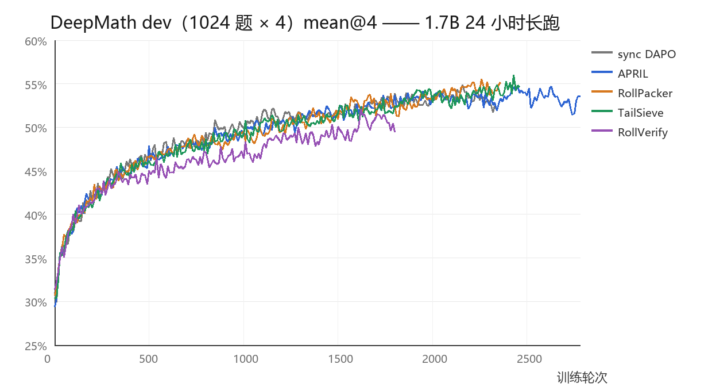
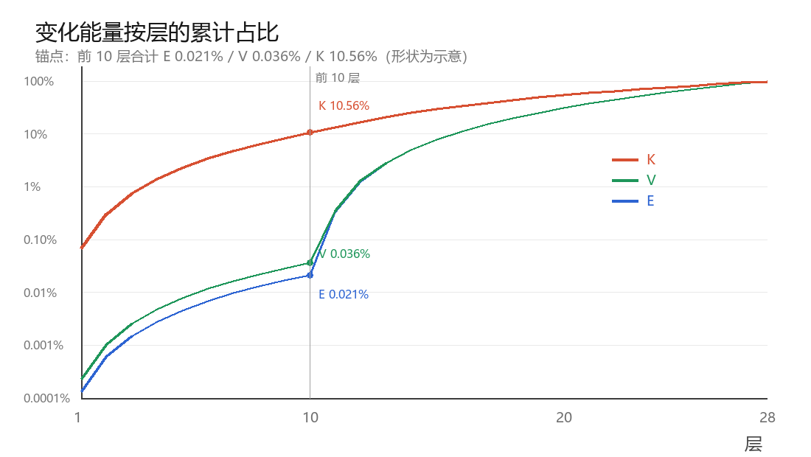
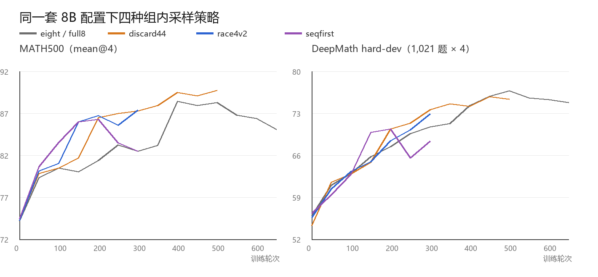
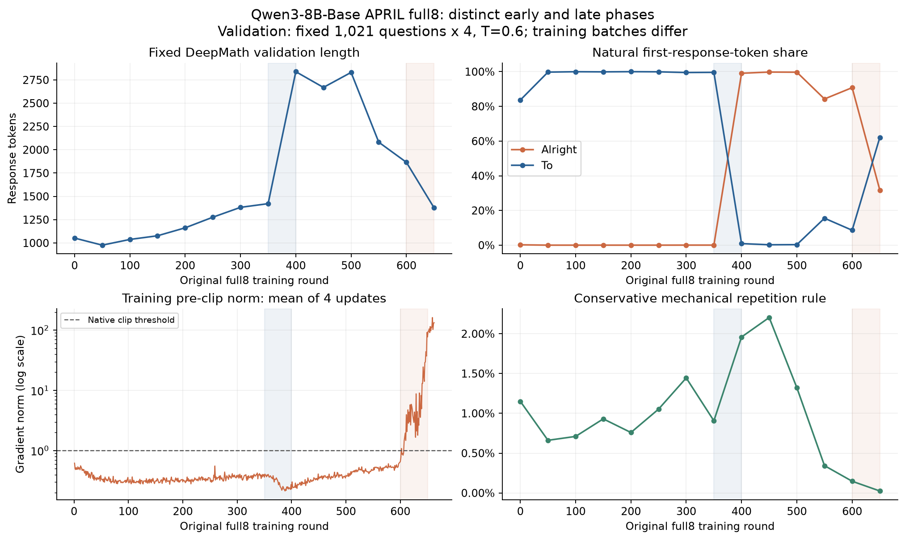
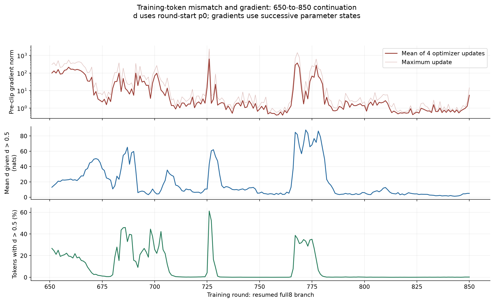
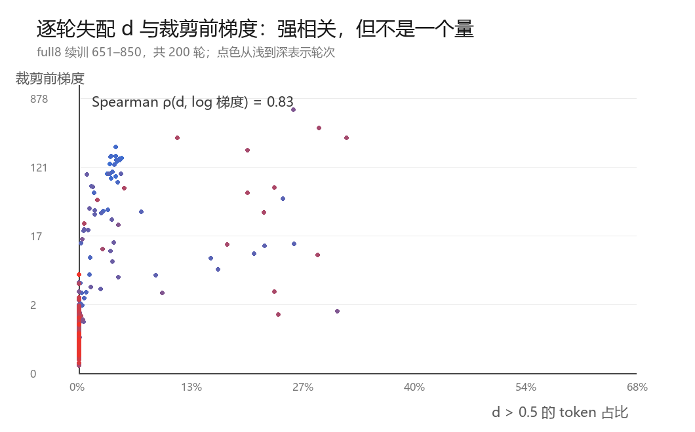

# RL 训练效率与稳定性：采样策略与异常梯度

> Qwen3-8B 数学 RL 上的两条研究线：长尾调度到底省不省时间，以及长度跃升 / 梯度异常 / 循环输出由什么驱动。45 个实验单元、52 条 claim，一半结论是被推翻的假设。

**类型** 项目 · **角色** 研究 + 工程 · **时间** 2026 · **状态** 已完成（八组对照只跑完 5/8）

[← 返回首页](../../README.md)

## 一、早期 1.7B 调度对照：常见的异步 rollout 方法

在 8B 之前，先用 Qwen3-1.7B-Base、DeepMath 20,000 题、4,096 token 上限跑了约 24 小时的长跑，横向看几类常见方案各自怎么处理「没完成的回答」：

| 方案 | 如何处理未完成的工作 | 24h 轮次 | 平均耗时 | DeepMath mean@4 | MATH transfer |
| :-- | :-- | --: | --: | --: | --: |
| 同步 DAPO | 等整组完成再更新 | 2,340 | 48.00 s | 51.90% | 63.28% |
| APRIL | 保留已生成的 token 前缀，跨权重更新续写 | **2,782（+18.9%）** | **30.45 s** | 53.59% | 65.04% |
| RollPacker（固定窗口 70） | 跨更新只保留题目、重新生成；短轮 + FIFO 长池 | 2,369 | 43.06 s | **55.15%** | **66.16%** |
| TailSieve | 长池与普通池并行，优先纳入长池有效组，再补足 56 组 | 2,465 | 35.63 s | 54.61% | **66.16%** |
| RollVerify | 按生成段和 token 两级校验旧前缀 | 1,806 | 54.62 s | 49.49% | — |

> RollPacker 另有一条「适配版」run（第 76 轮把窗口 112 改成 70），中途改配置，只能当过程记录；上表用的是固定窗口 70 的重跑。

### 1.1 我们怎么改这些机制

- **APRIL**：论文是一次性发起约 2 倍的组、每轮训练完再补题；我们改成**任意题目被消耗就补题**，让 GPU 上始终有 `112 × 8` 条 prompt 在跑，尽量不出现「一轮末尾没活干」的空档。
- **RollPacker**：论文一次性起 1.2 倍 prompt、G=10，每题只取最早的 8 条；我们保留动态补题，但**去掉了「10 拿 8」**，直接按 G=8 采——组的构成更简单，也少了一层按完成时间挑样本的偏差。
- **TailSieve**：长池和普通池并行，等长池判分完优先取它的有效组，再从普通池按完成顺序补足 56 组。
- **RollVerify**：基本是复现——按生成段和 token 两级校验可复用的旧前缀；但第 8 步窗口平均接受率只有 0.4113，太低，直接切回了同步生成。

四组共用同一套 1.7B / 4k / 56 个有效组的设置，所以横向看的是**机制差异**，不是论文原配置的复现。

## 二、跨权重 KV 复用：发现与实验

权重更新之后，能不能用旧缓存 + 已知的参数增量，低成本算出新缓存、省掉一部分 prefill？这是另一条独立线。

诊断都在 **Qwen3-1.7B** 上做：全参数 AdamW、lr 1e-6、每轮 32 题 × 8 回答、一次更新，保存 000–003 四个 checkpoint；比较「同一串 token 在相邻权重下」的缓存，用 teacher forcing 看后续分布。

### 2.1 发现：低层的 KV 几乎没变

- 逐层统计变化能量（占 28 层总变化的中位数）：前 10 层 **E 0.0209% / V 0.0361%，而 K 是 10.56%**。
- 这说明浅层的 E 和 V 基本可以照搬，只有 K 需要重算——一个很自然的分层方案：**浅层 E/V 复用、K 用新 Wk 重算、中高层整段重算**。

### 2.2 尝试复用：实验结果

按实际配置（B=128，prompt 131 + completion 250，共 381 个 token-step）算整批耗时：

| 方案 | 每 batch | 省 | cache 新鲜度 |
| :-- | --: | --: | :-- |
| 现状（prompt 也逐 token decode） | 9,599 ms | — | 新 |
| 复用整份旧 cache（不存 x） | 6,299 ms | **34.4%** | 陈旧 |
| 自己加真 prefill | 6,536 ms | 31.9% | 新 |
| 只复用底部 8 层 KV | 9,328 ms | **2.8%** | 部分陈旧 |
| 只复用底部 2 层 KV | 9,532 ms | **0.7%** | 部分陈旧 |

- **按层复用 KV 而不存 x，最多省 0.7%（2 层）到约 4.9%（外推 14 层）**——k/v 投影只占一层 MACs 的 13.33%，整栈复用也只到 13.3%，含 attention head 后 9.85%。

## 三、4+4：把采样预算挪给更难的题

### 3.1 起因：难一点的题更值得学

读到几篇工作，反复讲同一件事——**有对有错的题才有学习信号，越难的题单位采样换来的收益越大**：

- [DAPO](https://arxiv.org/abs/2503.14476) 的动态采样：全对 / 全错的组不产生梯度，直接丢弃，只保留 mixed 组；
- [DIVA-GRPO](https://arxiv.org/abs/2603.01106)：按题目难度自适应地调整采样与组优势；
- [ShorterBetter](https://arxiv.org/abs/2504.21370)：用组内最短的正确回答定义「最优长度」，把长度也当作信号。

结合我们自己的诉求——rollout 慢在长尾，很多题采到 8 条纯属浪费——就有了 **4+4**：先采 4 条，**全对说明题太简单，直接丢掉**，把预算留给别的题；否则再补 4 条凑满 G8。既省采样，又天然偏向「有分歧、更难」的题。

### 3.2 实验与结果

8B 上跑的三条轨迹（同一模型、数据与训练参数，只改组内采样规则）：

| 条件 | 组内生成规则 | 轮次提交 | 平均长度 | 平均事件间隔 | MATH500 | DeepMath |
| :-- | :-- | --: | --: | --: | --: | --: |
| `eight` / full8 | 八条并发，完整组判分 | 662 | 1,483 | **48.13 s** | 88.30% | **76.74%** |
| `nodiscard44` | 首四条完成判分后再发后四条，不丢弃 | 541 | 2,035 | 63.03 s | 85.95% | 74.49% |
| `discard44` | 首四条全对就丢弃，否则补齐八条 | 503 | 2,421 | 70.09 s | **89.75%** | 75.32% |

上面这组是**第 500 轮**（三条轨迹都跑到的公共检查点），换成最终权重或历史最优排序会变，但「full8 的 DeepMath 最好、discard44 的 MATH500 最好」这个结论不变。

**按难度档拆开看**（同一轮，DeepMath 五个档）：

| 难度档 | eight / full8 | nodiscard44 | discard44 |
| :-- | --: | --: | --: |
| D5–6 | **79.30%** | 74.61% | 77.54% |
| D6–7 | **76.27%** | 73.24% | 75.88% |
| D7–8 | **77.35%** | 76.33% | 76.57% |
| D8–9 | **76.93%** | 74.54% | 73.62% |
| D9–10（最难） | 67.02% | **68.09%** | 67.55% |
| 合计 hard-dev | **76.74%** | 74.49% | 75.32% |

- 趋势很清楚：**越简单的档，full8 越好；到最难一档反过来**——D9–10 上两个 4+4 都超过 full8（+0.5 与 +1.1pt）。
- 但总体仍是 full8 最高，因为它赢在低难度档的幅度更大。换句话说，4+4 把力气花在了最难的题上，代价是容易题掉分。

1.7B 那批长跑用的是另一套分档（DeepMath 分 D5 / D5.5 / D6，MATH 分 L3 / L4 / L5），这里不混用。

四组策略的完整曲线（每 50 轮一次验证）：

- **4+4 和 race4 是早熟型**：150–200 轮就到 86% / 70% 附近，而 full8 要到 400 轮才摸到 88%。
- **seqfirst 见顶即回落**：150 轮 86.0% 是它的最高点，之后一路降到 82.5%。
- **full8 慢热但后劲足**：MATH500 在 400 轮冲到 88.4%，hard-dev 在 500 轮摸到 76.7%，是四组里的最高点。
- 到 85% MATH500 所需轮数：seqfirst 150、race4v2 150、discard44 200、full8 400。

> 注意两条：每轮消耗的 token 不同（discard44 的回答长度 2,421 vs full8 1,483），所以「同轮次」不等于「同算力」；另外每组只有一条轨迹。

- **少生成 ≠ 更快**：长度从 1,483 涨到 2,421，平均事件间隔从 48 秒涨到 70 秒——省下的采样被更长的回答吃掉了。- **质量没有单一赢家**：MATH500 上 discard44 最好（89.75%），DeepMath 上 full8 最好（76.74%）；每条件只有一条轨迹，不能排名。
- **同 10 小时预算**：discard44 的 MATH500 89.75% vs full8 终点 85.10%（+4.65pt），但「最佳对最佳」只有 +1.35pt。
- **固定权重配对实验**（1.7B，不训练不丢弃）：4+4 的总耗时是八路并发的 **1.373 倍**，token 吞吐只有 **69.1%**——阶段等待抵消了生成节省。

后来为了不等前四条，还试了 
ace4：八条同发、最快四条全对就取消剩下的。首版取消接口有 bug（实际取消数为 0，120 轮作废），修复后的 
ace4v2 才拿到 334 轮有效记录。

## 四、长 token 与梯度异常

### 4.1 长度爆增：从现象到「掐掉首 token」

**现象：先是长度自己涨起来了**

- full8 在 350→400 轮，固定 1,021 题 × 4 的平均长度 **1,422 → 2,838 token**，几乎翻倍；
- 换别的调度也一样：4+4 discard 在 150→200 轮 **1,170 → 3,005**，4+4 keep 在 200→250 轮 **1,083 → 2,954**，race4v2 在 100→150 轮 **1,128 → 3,357**——发生轮次不同，但都涨了，而且这几次跃升期间轮均裁剪前梯度最大只有 **0.4075**。

**一个和常见说法不一样的观察**

- 很多工作报告「长度爆增和梯度异常总是同时出现」。我们这段正好相反：长度翻倍的时候梯度很平。
- 后期更明显的是反向：600→650 轮，评测长度从 **1,866 降到 1,377**，梯度却从 **0.658 涨到 77.276**；机械重复也降到 1/4084。
- 所以在我们的轨迹里，**长度和梯度各走各的**，不能互相当代替信号。

**分析：变长和「开头」有关**

- 一开始不知道长度为什么涨。把固定 64 题的首 token 单独拉出来看：`P(Alright)` 从 100 轮的 1.97%，到 120 轮 15.93%、130 轮 68.57%、150 轮 **97.69%**；逐题 log-odds 线性拟合中位 R² 约 0.965——像是多步积累后在 sigmoid 上陡升。
- 同期 `Alright` 开头的占比从 0.02% 到 99.09%，而它开头的回答本身就更长。于是猜想：模型不是在学更长的推理，而是在学一个**开头模式**。

**干预：掐掉首 token**

在固定历史 batch 重放里，**只把第一个生成 token 的优势系数置零**（保留原 response mask 和分母），从第 119 轮的同一状态续跑到 140 轮，再做 64 题 × 4 自然生成。对照两组：随机删一个非首 token、按原 `p0` 的 NLL 匹配删一个非首 token——用来排除「只是少训练了一个 token」。

| 处理 | 平均长度 | Alright 开头 / 256 |
| :-- | --: | --: |
| 原损失 | 3,328 | 247 |
| **去掉首 token 的直接损失** | **2,035** | **65** |
| 去掉随机一个非首 token | 3,360 | 235 |
| 去掉 NLL 匹配的非首 token | 3,271 | 241 |

**效果**

- 长度 **3,328 → 2,035（−39%）**，`Alright` 开头 **247 → 65**；删别的 token 几乎不动。
- 说明变长确实由「学开头模式」驱动，掐掉首 token 的直接信号就能把长度按住。
- 代价：正确数 158/256 vs 对照 167/256，差在区间内，但提醒「压长度会动质量」。

> 这是固定数据重放，不是在线训练；它证明的是机制，不是一份可以直接上线的补丁。

### 4.2 梯度与概率失配

- **峰值集中在 B2/B3**，但不是「第 2/3 次执行」本身导致——同一批回答在不同 checkpoint 上的反向响应差异很大。
- **负优势 token 的权重位置比同量缩放更重要**；大的逐 token 失配 $d_t$ 是好的诊断和干预定位信号，但**不是梯度范数的充分条件**。
- **FP16 不是已证实的通用修复**；同输入、同更新，数值路径本身也存在非确定性。

### 4.3 循环与失配

- 持续重复与严重失配**强关联但不等价**：有「正常文本但失配大」的反例，也有「长循环但失配小」的反例。
- **跨权重续写不是必要条件**：同权重、无跨轮滞后也能出现大的失配。
- **「strict 重复归零」不等于修复**：三个 740 端点仍有 19 / 92 / 48 条数字循环。

### 4.4 先讨论 $d_t$ 和梯度到底什么关系

4.1 那张主线全貌里，梯度在 600 轮后突然抬升。这一节要回答的是：**它跟 $d_t$ 到底什么关系**。

**在 650→850 的续训分支里，$d$ 和梯度是一起动的**

梯度峰（约 725 轮、770 轮）和 $d$ 的峰基本对齐，$d>0.5$ 的 token 占比同步冲到 30–60%。所以在时间维度上「$d$ 大 ↔ 梯度大」是成立的——但这只是相关，还不足以说明因果。

把 200 轮摊成散点看得更清楚：

- 秩相关 **ρ = 0.83**，确实是强同向；
- 但同一个 $d$ 水平下，梯度能横跨 **1–2 个数量级**（比如 2% 左右的失配，梯度从 2 到 200 都有）。
- 所以 $d$ 只能当**预警信号**，不能当换算公式。下面用交叉实验把「数据」和「权重状态」这两个因素拆开。

**先把 $d_t$ 定义清楚**：rollout 采样时记录了每个 token 的概率 $q$；本轮更新前再用训练路径重算一遍，得到锚点 $p_0$。逐 token 的失配就是

$$d_t = |\ln p_{0,t} - \ln q_t| \quad (\text{nats})$$

它衡量的是「采样时的策略」和「训练时重算的策略」对同一个 token 有多不一致，**不是** PPL 差、不是 $|p-q|$，也不是全词表 KL。梯度则写成 $\sum_t c_t \nabla_\theta \log p_\theta$，其中 $c_t$ 汇总了优势、PPO ratio、裁剪、mask 和归一化——$d_t$ 只影响其中一部分，所以「失配大 ⇒ 梯度大」并不天然成立，得测。

**3×2 交叉实验**：三批历史数据（第 501 / 601 / 701 轮的 rollout）分别放到两份权重（600 / 700）上，固定优势、mask、分母，只做一次冻结反传：

| 数据批 | 权重 600：$d_t$ 均值 / 梯度范数 | 权重 700：$d_t$ 均值 / 梯度范数 |
| :-- | --: | --: |
| 501 轮（168 条） | 0.135 / 0.47 | 0.302 / 6.99 |
| 601 轮（512 条） | 0.062 / 0.51 | 3.852 / **77.35** |
| 701 轮（512 条） | 0.472 / 32.85 | 0.980 / **142.65** |

三个读数：

1. **同一批数据换权重，梯度能差两个数量级**：601 批在 600 权重上 0.51，换到 700 权重变 77.35（×150）；对应的 $d_t$ 也从 0.06 涨到 3.85。
2. **同一份权重换数据，同样差很多**：700 权重下，501 / 601 / 701 三批分别是 6.99 / 77.35 / 142.65（×20）。
3. **$d_t$ 和梯度同向，但不是等式**：601×600 的 $d_t$ 只有 0.062、梯度 0.51；701×600 的 $d_t$ 是它的 7.6 倍（0.47），梯度却是 64 倍（32.85）——乘上去的是模型状态本身的响应。

为了排除「是不是损失系数在变」，另做了一次更干净的对照：同一 batch、固定优势和 mask、把 PPO ratio 强制成 1，只换 720 / 730 两份权重——B2 和 B3 的梯度仍相差 **11.2 倍 / 9.1 倍**。

> 所以我们的结论是：**异常梯度是「数据 × 权重状态」的联合产物**。既不能说某一批回答自带异常，也不能说 $d_t$ 大梯度就一定大——$d_t$ 是很好的定位信号，不是充分条件。

### 4.5 八组干预对照（同一 600 状态）

| # | 方法 | 机制 | 最大裁剪前梯度 | 平均梯度 | d>0.5 | 650 主面板 | 循环候选 | 乱码候选 |
| :-- | :-- | :-- | --: | --: | --: | --: | --: | --: |
| 0 | Baseline | 原 APRIL full8 | 142.31 | 9.38 | 12.23% | 51.56% | 10.81% | 12.31% |
| 1 | Full TIS | 全部 token 乘权重 | **0.91** | 0.66 | 0.026% | 49.41% | 0.007% | 0.67% |
| 2 | Negative TIS | 仅负优势 token 乘权重 | 1.11 | **0.60** | **0.009%** | 51.56% | 0.011% | 0.91% |
| 3 | Absolute-gap mask | ｜s0｜>0.5 置零 | 254.57 | 11.59 | 27.86% | 53.12% | **4.96%** | **16.33%** |
| 4 | Negative-down mask | A<0 且 s0<−0.5 置零 | 9.29 | 1.75 | 12.23% | 52.15% | 0* | 42* |

\* 第 4 组只有 650 单点，分母与 0–3 的 50 轮累计不同，不能直接横比。

- **只有 TIS 真正压住梯度**，且是「整体压低」（最大与平均同量级），不是砍单个尖峰。
- Full TIS 压住梯度但掉点（650 主面板 −2.15pt）；Negative TIS 次要面板 +3.91pt，但单轨迹、未做多重比较校正。
- **降循环 ≠ 修复输出**：Absolute-gap 循环 10.81% → 4.96%，乱码 12.31% → 16.33%。
- **裁剪前梯度 ≠ 更新幅度**：Negative-down 峰值 142.31 → 9.29、>10 次数 41 → 0，但 Adam 位移反而略高（0.0190 vs 0.0170）。

## 五、被证伪或修正的假设

| 最初猜想 | 当前判断 |
| :-- | :-- |
| 长度跃升 = 训练数值爆炸 | 对早期现象不成立 |
| 偶尔采到更好的 `Alright` 形成正反馈 | 有支持，但没锁定单次触发 |
| 坏题触发爆炸 | 数据影响是风险，单根因未证实 |
| 大 $d$ 是梯度异常的直接原因 | 能定位 loss 项，但没单独操纵过 $d$ |
| 严重失配来自跨权重续写 | 版本滞后不是必要条件 |
| 持续重复与失配等价 | 条件性强关联，非充分必要 |
| 只压重复就能改善训练 | pulse / E-only UL / 在线 UL 都没有成功证据 |
| 梯度低 = 模型变好 | 已否定（TIS 就是反例） |

## 六、方法：证据怎么分级

- **先定口径**：裁剪前梯度 ≠ 实际更新量；token 加权 PPL ≠ 逐 token PPL；机械重复标签 ≠ 语义判定；轮次提交 ≠ Adam step。
- **按证据强度分层**：结构测量 / oracle 拟合 → 固定 token 探针 → 固定 batch 重放 → 在线训练分支 → 固定题评测，每层能回答什么、不能回答什么都写清楚。
- **工程可复现**：45 个实验单元、52 条 claim；CI 校验链接、证据编号、聚合数据一致性与 reference 哈希，图表可离线重绘。

## 七、局限

- 8B 多数结果是**单条训练轨迹**；八组对照只完成 5/8 组训练、4/8 组完整分析，不能排名。
- 没有多种子、与 baseline 匹配的长期有效修复；Negative TIS 的 +3.91pt 未做多重比较校正。
- 缓存实验是 teacher forcing、24 个 case、只跨 1 次更新，不是在线训练，也没有端到端加速。
- 检测器有漏检与误报；诊断前缀存在事后选择；题目 bootstrap 不覆盖训练种子差异。

## 参考

- [dapo-rollout-stability（45 个实验单元 / 52 条 claim）](https://github.com/LingyinKaslana/dapo-rollout-stability)
